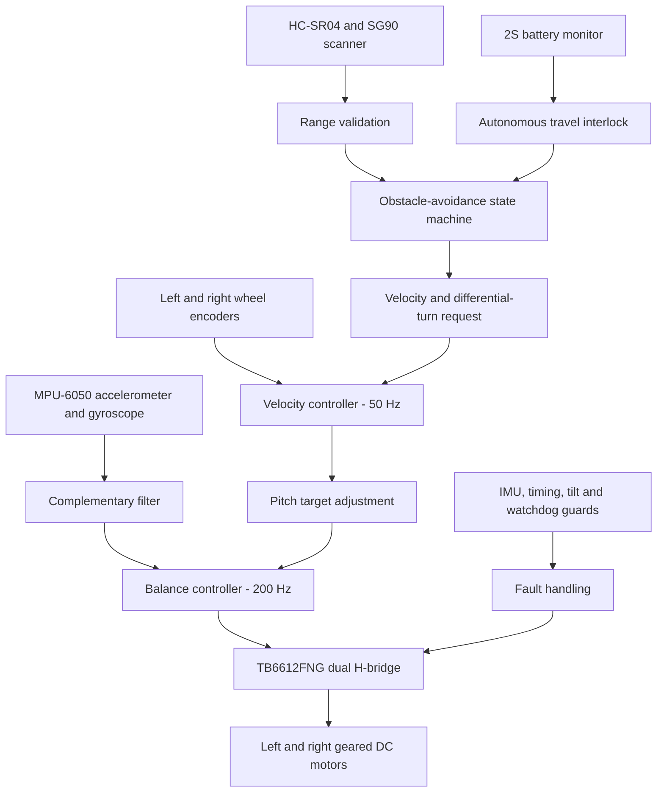

# GyroGuard

**A two-wheel self-balancing robot with autonomous obstacle avoidance.**

[](https://github.com/3more102/gyroguard-self-balancing-robot/actions/workflows/arduino-ci.yml)
[](LICENSE)
[](https://www.arduino.cc/)

GyroGuard is an embedded-systems and control-engineering project built around a **differential-drive, two-wheel inverted pendulum**. It uses an Arduino Uno R3 or classic Nano (ATmega328P, 16 MHz) to estimate body pitch, stabilize the chassis, regulate wheel velocity, and navigate around detected obstacles.

The firmware combines real-time balance control with sensor validation, motion feedback, battery monitoring, and conservative fault handling. A MATLAB/Octave model and host-side unit tests support the control-system work.

> **Project scope:** GyroGuard is an engineering prototype and learning platform, not a finished consumer robot. Firmware defaults are starting points; reliable operation depends on the actual motors, mechanics, wiring, calibration, and controller tuning.

## Contents

- [Key features](#key-features)
- [System architecture](#system-architecture)
- [Hardware](#hardware)
- [Wiring and pin assignments](#wiring-and-pin-assignments)
- [Repository structure](#repository-structure)
- [Build and upload](#build-and-upload)
- [First startup and operation](#first-startup-and-operation)
- [Control system and safety behavior](#control-system-and-safety-behavior)
- [Tests and continuous integration](#tests-and-continuous-integration)
- [Mathematical model](#mathematical-model)
- [Safety notes and limitations](#safety-notes-and-limitations)
- [License](#license)

## Key features

- **Two-wheel balancing:** one driven wheel on each side of a shared axle; no caster or third support wheel.
- **200 Hz attitude and balance loop:** MPU-6050 accelerometer/gyroscope fusion using a complementary filter, with gyro-rate damping and bounded PID output.
- **50 Hz velocity loop:** quadrature encoder feedback adjusts the balance-angle target to regulate travel speed.
- **Obstacle detection:** HC-SR04 ultrasonic ranging on an SG90 scanning servo.
- **Non-blocking sensing:** echo capture uses an AVR pin-change interrupt so ranging does not block the balance loop.
- **Conservative navigation:** a state machine validates range data before authorizing forward motion or a differential turn.
- **Battery supervision:** monitors a protected 2-cell Li-ion pack and inhibits autonomous travel when voltage is low, invalid, or unavailable.
- **Motion supervision:** encoder watchdogs detect missing wheel motion during straight travel and turns.
- **Fault handling:** IMU identity checks, startup calibration validation, bounded I²C transactions, control-timing checks, tilt limits, and watchdog-reset recovery.
- **Explicit arming:** motor outputs remain disabled after boot; balancing and autonomous travel require separate serial commands.
- **Engineering tools:** host-side C++ tests, MATLAB/Octave plant analysis, and GitHub Actions build checks.

## System architecture

The balance controller remains active independently of the navigation logic. Obstacle sensing changes the motion request; it does not replace or pause the real-time balance loop.



## Hardware

| Component | Recommended configuration | Purpose |
|---|---|---|
| Controller | Arduino Uno R3 or classic Nano, ATmega328P | Real-time control |
| IMU | MPU-6050 / GY-521 breakout | Pitch and angular-rate measurement |
| Motors | 2 matched geared DC motors with quadrature encoders | Drive and motion feedback |
| Wheels | 2 matched wheels on one axle | Differential drive and dynamic balance |
| Motor driver | TB6612FNG dual H-bridge | Bidirectional motor control |
| Distance sensor | HC-SR04 | Forward obstacle ranging |
| Scanner | SG90 micro servo | Left/center/right sensor scanning |
| Battery | Protected 2-cell Li-ion pack (7.4 V nominal) | Motor and system power |
| Logic supply | Regulated 5 V buck converter | Arduino and sensor supply |
| Battery monitor | 2 × 10 kΩ, 1% resistors and 100 nF capacitor | Battery-voltage measurement |
| Mechanical parts | Rigid chassis, motor mounts, brackets and fasteners | Structural support |

**Mechanical requirement:** install exactly two driven wheels, one on each side of the chassis, coaxial with one another. The robot balances dynamically and will not remain upright with motor power disabled.

Select motors using their **stall current at the intended supply voltage**, not only their nominal running current. Confirm that the actual TB6612FNG breakout, battery, wiring, and thermal design can safely support the load.

For the full parts checklist, electrical notes, and assembly guidance, see [Hardware and Wiring](docs/HARDWARE.md).

## Wiring and pin assignments

The following pin map matches the current firmware defaults in `firmware/GyroGuard/config.h`.

### Sensors and feedback

| Device signal | Arduino pin |
|---|---|
| MPU-6050 SDA | A4 |
| MPU-6050 SCL | A5 |
| Left encoder channel A | D2 (INT0) |
| Left encoder channel B | D4 |
| Right encoder channel A | D3 (INT1) |
| Right encoder channel B | D7 |
| HC-SR04 TRIG | A0 |
| HC-SR04 ECHO | A1 (pin-change interrupt) |
| SG90 signal | D9 |
| Battery-divider midpoint | A2 |

### TB6612FNG motor driver

| Driver signal | Arduino pin |
|---|---|
| PWMA — left motor PWM | D5 |
| AIN1 — left motor direction | D8 |
| AIN2 — left motor direction | D10 |
| PWMB — right motor PWM | D6 |
| BIN1 — right motor direction | D11 |
| BIN2 — right motor direction | D12 |
| STBY | A3 |

The Servo library uses Timer1 on the Uno/Nano. Motor PWM is therefore assigned to D5 and D6. Do not move the HC-SR04 Echo signal without also updating the pin-change interrupt implementation.

### Power and wiring precautions

- Use a regulated 5 V supply with sufficient peak-current capacity for the controller, sensors, and servo. **Do not power the motors or servo from the Arduino 5 V pin.**
- Connect all system grounds together.
- Feed the motor driver VM from a battery compatible with the motors and the exact driver breakout.
- The documented battery divider is for a protected **2S pack only**. Never connect raw battery positive directly to A2, and do not use this divider with a 3S or higher-voltage pack.
- Verify the divider output is below 4.3 V when the 2S pack is fully charged (8.4 V).
- Add a 10 kΩ pull-down from TB6612FNG STBY to GND only after checking whether the specific breakout already has a pull-down or a pull-up.
- Avoid powering the Uno simultaneously from USB and an external 5 V rail unless the board's power arrangement safely supports it.

Read [Hardware and Wiring](docs/HARDWARE.md) before connecting the battery or motors.

## Repository structure

```text
gyroguard-self-balancing-robot/
├── firmware/
│   └── GyroGuard/
│       ├── GyroGuard.ino          # Main application and scheduler
│       ├── config.h               # Pins, timing, gains and limits
│       ├── watchdog_startup.cpp / watchdog_startup.h
│       ├── reset_policy.h          # Reset flags and armed-state marker policy
│       ├── pid.*                  # PID controller
│       ├── imu_mpu6050.*           # MPU-6050 interface
│       ├── encoder.*               # Quadrature encoder feedback
│       ├── motor_driver.*          # TB6612FNG interface
│       ├── sonar.*                 # Non-blocking ultrasonic capture
│       ├── obstacle_avoidance.*    # Servo scanning and navigation
│       ├── battery_monitor.*       # Battery-voltage measurement
│       └── *_guard.*               # Validation and safety policies
├── docs/
│   ├── HARDWARE.md
│   ├── COMMISSIONING.md
│   ├── MATHEMATICAL_MODEL.md
│   ├── MEASUREMENT_WORKSHEET.md
│   ├── RESOURCE_BUDGETS.md
│   └── WATCHDOG.md
├── matlab/
│   ├── gyroguard_parameters.m
│   ├── gyroguard_stage2_analysis.m
│   └── README.md
├── tests/                          # Host-side C++ unit tests and fakes
├── .github/workflows/
│   └── arduino-ci.yml
└── README.md
```

## Build and upload

### Requirements

- Arduino IDE 2.x or Arduino CLI
- Arduino AVR Boards core
- Arduino Servo library
- A USB data cable and the correct serial port for your board
- A C++11 compiler for running host-side tests
- GNU Octave or MATLAB for model analysis

### Install the Arduino toolchain

```bash
arduino-cli core update-index
arduino-cli core install arduino:avr
arduino-cli lib install Servo
```

### Compile for Arduino Uno R3

Run from the repository root:

```bash
arduino-cli compile --fqbn arduino:avr:uno firmware/GyroGuard
```

### Compile for classic Arduino Nano

```bash
arduino-cli compile --fqbn arduino:avr:nano firmware/GyroGuard
```

### Upload

Connect the board, identify its serial port, and upload:

```bash
arduino-cli upload -p YOUR_PORT --fqbn arduino:avr:uno firmware/GyroGuard
```

For a classic Nano, use `arduino:avr:nano` as the FQBN. Some Nano-compatible boards require a different bootloader/processor option; select the one matching your board.

You can also open `firmware/GyroGuard/GyroGuard.ino` in Arduino IDE, select the correct board and port, then compile and upload.

## First startup and operation

**Do not begin autonomous navigation until balance-only operation is stable.**

1. Assemble the two-wheel chassis and complete the wiring checks in [Hardware and Wiring](docs/HARDWARE.md).
2. Keep the motor battery disconnected while compiling and uploading the firmware.
3. Open Serial Monitor at **115200 baud**.
4. Hold the robot upright and stationary during the startup IMU calibration (approximately 3 seconds).
5. Confirm that pitch increases when the top of the robot is tilted forward and decreases when tilted backward.
6. With the wheels raised, verify motor direction and encoder polarity before attempting to balance.
7. Support the robot in a clear test area. Hold it within 8° of upright and below 10°/s pitch rate, then send `b` to arm balance.
8. Tune and verify balance-only operation before sending `a` to enable autonomous cruise and obstacle avoidance.
9. Use `s` to stop autonomous travel while keeping the balance controller active.
10. Use the physical battery switch for an emergency power cut.

### Serial commands

| Command | Function |
|---|---|
| `b` | Arm the balance controller when the IMU sample is fresh and the robot is sufficiently upright and still |
| `a` | Enable autonomous cruise and obstacle avoidance; requires balance to be armed and valid battery conditions |
| `s` | Stop autonomous travel while keeping balance active |
| `d` | Disarm motor outputs; the robot will fall unless physically supported |
| `t` | Toggle telemetry |
| `?` | Display command help |

The firmware blocks balance arming if the latest IMU sample is older than 15 ms, the pitch is outside 8° of upright, or the pitch rate is 10°/s or higher.

For the complete, ordered calibration and tuning procedure, see [Commissioning and Tuning](docs/COMMISSIONING.md).

## Control system and safety behavior

### Control loops

| Layer | Rate | Responsibility |
|---|---:|---|
| Attitude estimation and balance | 200 Hz | Estimate pitch and stabilize the body |
| Wheel-velocity control | 50 Hz | Use encoder feedback to adjust the pitch target |
| Main telemetry | 10 Hz | Report pitch, rate, speed, target, motor command and state |
| Battery sampling | 10 Hz | Monitor pack voltage and travel-inhibit conditions |

### Navigation policy

- The HC-SR04 is scanned at center during travel and to the left/right when an obstacle is detected.
- Forward motion requires a fresh, valid center-range measurement.
- Unknown, invalid, or stale range data does not authorize forward travel.
- After a scan or turn, the center servo must settle and a new forward measurement must confirm clearance.
- If neither side has verified clearance, the robot holds position and retries sensing.
- The robot does not reverse because it has no rear-facing range sensor.

### Fault handling and interlocks

- Motor outputs are disabled on boot. A normal boot or watchdog reset never automatically re-arms the robot.
- An unexpected reset while balance was armed is detected by a validated two-word `.noinit` marker; startup latches a motor-off fault until the robot is inspected and deliberately power-cycled.
- MPU-6050 identity is checked, startup calibration is validated, and I²C transactions are bounded by a 5 ms timeout.
- A tilt beyond the configured 32° safety limit or a control-loop gap beyond 20 ms triggers a latched control fault and disables the motor driver.
- Low or invalid battery voltage inhibits autonomous travel while the balance controller remains active. The default 2S travel-inhibit threshold is 6.8 V; recovery requires at least 7.0 V and a deliberate new `a` command.
- During straight autonomous travel, both encoders must report motion within 750 ms. During a differential turn, at least one encoder must report motion within 400 ms.
- An encoder-motion fault inhibits autonomous travel and requires a power cycle after inspection.

These are firmware guardrails, not substitutes for correct wiring, current limiting, mechanical inspection, or supervised testing. See [Watchdog Recovery](docs/WATCHDOG.md) for reset behavior.

## Tests and continuous integration

The GitHub Actions workflow runs:

- C++11 host unit tests for PID control, navigation policy, range validation, sonar classification, obstacle-avoidance state transitions, servo settling, IMU validation, balance arming, encoder-motion supervision, and battery monitoring.
- MATLAB/Octave Stage 2 model checks using GNU Octave.
- Arduino Uno and classic Nano new- and old-bootloader compilation.
- Flash and static SRAM checks for each AVR target.

The current CI budgets are **24,000 bytes of flash** and **1,200 bytes of static SRAM** per target. The SRAM budget leaves at least 848 bytes for runtime stack and other dynamic use on the ATmega328P. Passing the static budget does not replace stack analysis or hardware stress testing.

Run individual host tests from the repository root:

```bash
g++ -std=c++11 -Wall -Wextra -Werror tests/test_pid.cpp firmware/GyroGuard/pid.cpp -o /tmp/gyroguard-pid-test
/tmp/gyroguard-pid-test

g++ -std=c++11 -Wall -Wextra -Werror tests/test_navigation_policy.cpp -o /tmp/gyroguard-navigation-test
/tmp/gyroguard-navigation-test

g++ -std=c++11 -Wall -Wextra -Werror tests/test_range_guard.cpp -o /tmp/gyroguard-range-guard-test
/tmp/gyroguard-range-guard-test

g++ -std=c++11 -Wall -Wextra -Werror tests/test_sonar_math.cpp -o /tmp/gyroguard-sonar-test
/tmp/gyroguard-sonar-test

g++ -std=c++11 -Wall -Wextra -Werror -I tests/fakes tests/test_navigation_state_machine.cpp firmware/GyroGuard/obstacle_avoidance.cpp -o /tmp/gyroguard-navigation-state-machine-test
/tmp/gyroguard-navigation-state-machine-test

g++ -std=c++11 -Wall -Wextra -Werror tests/test_imu_validation.cpp -o /tmp/gyroguard-imu-validation-test
/tmp/gyroguard-imu-validation-test

g++ -std=c++11 -Wall -Wextra -Werror -I tests/fakes tests/test_servo_center_settle.cpp firmware/GyroGuard/obstacle_avoidance.cpp -o /tmp/gyroguard-servo-settle-test
/tmp/gyroguard-servo-settle-test

g++ -std=c++11 -Wall -Wextra -Werror tests/test_balance_arming.cpp -o /tmp/gyroguard-arm-test
/tmp/gyroguard-arm-test

g++ -std=c++11 -Wall -Wextra -Werror tests/test_motion_guard.cpp -o /tmp/gyroguard-motion-guard-test
/tmp/gyroguard-motion-guard-test

g++ -std=c++11 -Wall -Wextra -Werror tests/test_battery_policy.cpp -o /tmp/gyroguard-battery-policy-test
/tmp/gyroguard-battery-policy-test

g++ -std=c++11 -Wall -Wextra -Werror -I tests/fakes_battery tests/test_battery_monitor.cpp firmware/GyroGuard/battery_monitor.cpp -o /tmp/gyroguard-battery-monitor-test
/tmp/gyroguard-battery-monitor-test

g++ -std=c++11 -Wall -Wextra -Werror tests/test_reset_policy.cpp -o /tmp/gyroguard-reset-policy-test
/tmp/gyroguard-reset-policy-test

g++ -std=c++11 -Wall -Wextra -Werror tests/test_encoder_math.cpp -o /tmp/gyroguard-encoder-math-test
/tmp/gyroguard-encoder-math-test
```

## Mathematical model

The repository includes a parameterized sagittal-plane, two-wheel inverted-pendulum model. It accounts for motor reaction torque on the body, motor back-EMF based on rotor speed relative to the body-mounted stator, and reflected motor-rotor inertia in the coupled mass matrix.

Run from the repository root in MATLAB:

```matlab
addpath('matlab');
results = gyroguard_stage2_analysis(false);
```

Or run with GNU Octave:

```bash
octave --quiet --eval "addpath('matlab'); gyroguard_stage2_analysis(false);"
```

The analysis checks actuation signs, compares analytical linearization with finite-difference Jacobians, reports open-loop poles and controllability, and compares nonlinear and linearized fall responses.

**Important:** the supplied model parameters are illustrative placeholders, not measured properties of the assembled robot. Complete [the Measurement Worksheet](docs/MEASUREMENT_WORKSHEET.md) and update `matlab/gyroguard_parameters.m` before using numerical results as hardware-specific evidence. See [the Mathematical Model](docs/MATHEMATICAL_MODEL.md) for assumptions and derivation.

## Safety notes and limitations

- Perform initial motor and encoder checks with the wheels raised. Use a tether or soft catch area for first balance tests.
- Keep hands, hair, cables, and loose clothing away from the wheels. Keep an accessible physical power switch and battery disconnect.
- Verify motor stall current against the actual motor-driver breakout and battery limits before applying motor power.
- The HC-SR04 is a single-beam sensor. Soft, narrow, angled, or sound-absorbing objects may not produce reliable echoes.
- Echoes inside the nominal 30 mm near-field range are treated as obstructions, not precise distance measurements.
- A single front scanner does not provide 360° perception, rear coverage, SLAM, or map-based navigation.
- The avoidance turn is a timed differential-drive maneuver. It is not a localization or path-planning system.
- The battery monitor is a travel interlock, not a battery-management system. Use a protected 2S pack/BMS and a suitable charger.
- Encoder watchdogs detect missing motion pulses; they do not detect every possible wiring, polarity, or intermittent-feedback fault.
- Software cannot compensate for an under-rated motor driver, loose chassis, poor wheel alignment, unsuitable motors, or incorrect IMU mounting.
- Never assume that a successful compile or passing unit tests proves the assembled robot is safe or stable.

Read the [Hardware Guide](docs/HARDWARE.md) and [Commissioning Guide](docs/COMMISSIONING.md) before powered testing.

## License

This project is licensed under the [MIT License](LICENSE).
