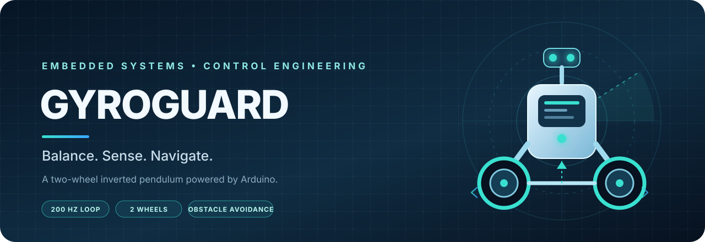
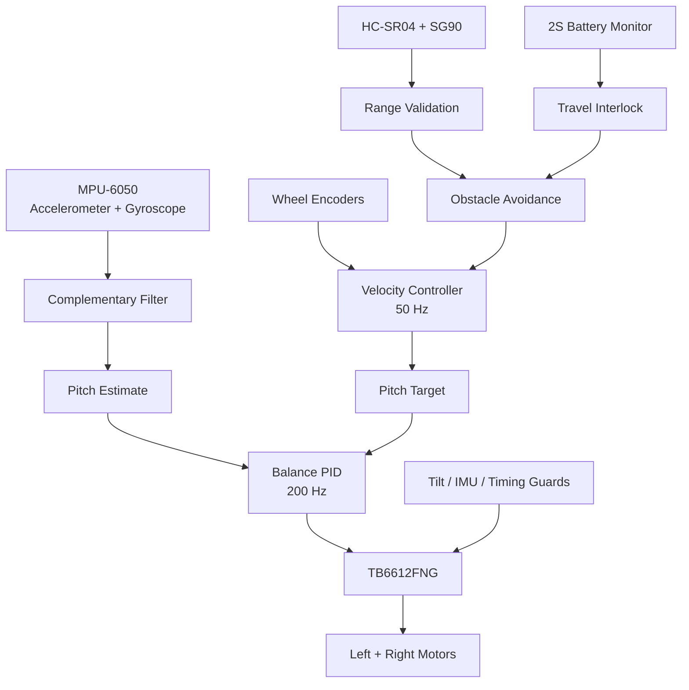
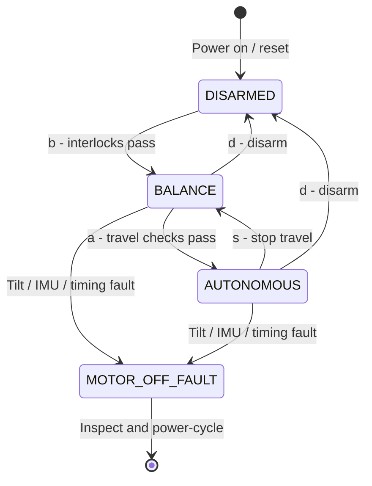

<div align="center">



### Stay upright. See ahead. Move with intent.

**An Arduino-powered, two-wheel self-balancing robot with autonomous obstacle avoidance.**

[](https://github.com/3more102/gyroguard-self-balancing-robot/actions/workflows/arduino-ci.yml)
[](LICENSE)
[](https://www.arduino.cc/)
[](https://isocpp.org/)

[**Explore the firmware**](firmware/GyroGuard) · [**Build the robot**](docs/HARDWARE.md) · [**Tune the controller**](docs/COMMISSIONING.md) · [**Understand the model**](docs/MATHEMATICAL_MODEL.md)

</div>

---

## Meet the robot

GyroGuard is a control-engineering project built around a **two-wheel, differential-drive inverted pendulum**. An Arduino Uno R3 or classic Nano reads an MPU-6050, estimates the robot's pitch, and continuously drives two geared motors to keep the chassis upright.

Once balance-only operation is stable, a scanning ultrasonic sensor adds a second job: detect obstacles and choose a cautious direction of travel.

The interesting part is not simply making the robot move. It is coordinating estimation, feedback control, sensing, navigation, and fault handling on a resource-constrained 8-bit microcontroller.


> **The mechanical rule:** two driven wheels on one shared axle. No caster. No third support wheel. The robot balances dynamically.

> [!IMPORTANT]
> **This is an engineering prototype, not a ready-to-drive product.** Initial gains and mechanical values are starting points, not proof of stability. Test with the wheels raised first, then use a tether or soft catch area. Keep an accessible physical power switch.

## At a glance

| ⚡ Balance | 🧭 Navigate | 🛡️ Protect | 🧪 Verify |
|---|---|---|---|
| 200 Hz attitude loop | HC-SR04 scanning | IMU and timing guards | C++ unit tests |
| 50 Hz velocity loop | Servo left/center/right | Battery travel inhibit | Uno/Nano CI builds |
| Complementary filter | Differential turns | Encoder motion watchdog | MATLAB / Octave model |
| PID + gyro damping | Fresh-range checks | Watchdog reset recovery | Flash / SRAM budgets |

## How GyroGuard works

The balance loop is the priority. Navigation can request a change in speed or turning direction, but it must never pause the attitude controller.



### The control rhythm

1. **Sense** — read acceleration, angular rate, wheel motion, battery voltage, and ultrasonic echoes.
2. **Estimate** — combine accelerometer and gyroscope data to estimate body pitch.
3. **Balance** — run the inner controller at 200 Hz and command both motors to correct the fall.
4. **Regulate** — use encoder feedback at 50 Hz to adjust the pitch target for requested travel speed.
5. **Navigate** — scan for obstacles and request cautious forward motion or a differential turn.
6. **Guard** — reject stale or invalid data and inhibit unsafe movement.

## The hardware

| Part | Baseline | Role |
|---|---|---|
| Controller | Arduino Uno R3 / classic Nano (ATmega328P, 16 MHz) | Real-time firmware |
| IMU | MPU-6050 / GY-521 | Pitch and angular-rate sensing |
| Drive | 2 matched geared DC motors with quadrature encoders | Balance and movement |
| Wheels | 2 matched wheels on one axle | Differential drive |
| Motor driver | TB6612FNG dual H-bridge | Motor power stage |
| Distance sensor | HC-SR04 | Obstacle ranging |
| Servo | SG90 micro servo | Sensor scanning |
| Battery | Protected 2-cell Li-ion pack (7.4 V nominal) | Main power |
| Logic supply | Regulated 5 V buck converter | Arduino and peripherals |

**Motor selection matters:** check each motor's stall current at the intended voltage against the actual driver breakout's continuous-current and thermal limits. Do not size the system using a peak-current headline alone.

→ Full bill of materials, wiring, power design, and assembly notes: **[Hardware Guide](docs/HARDWARE.md)**

## Pin map

These assignments match the current defaults in `firmware/GyroGuard/config.h`.

<details>
<summary><strong>Open sensor, encoder, and motor-driver pin assignments</strong></summary>

### Sensors and feedback

| Signal | Arduino pin |
|---|---:|
| MPU-6050 SDA | A4 |
| MPU-6050 SCL | A5 |
| Left encoder A | D2 (INT0) |
| Left encoder B | D4 |
| Right encoder A | D3 (INT1) |
| Right encoder B | D7 |
| HC-SR04 TRIG | A0 |
| HC-SR04 ECHO | A1 (pin-change interrupt) |
| SG90 signal | D9 |
| Battery-divider midpoint | A2 |

### TB6612FNG

| Signal | Arduino pin |
|---|---:|
| PWMA — left PWM | D5 |
| AIN1 — left direction | D8 |
| AIN2 — left direction | D10 |
| PWMB — right PWM | D6 |
| BIN1 — right direction | D11 |
| BIN2 — right direction | D12 |
| STBY | A3 |

The Servo library uses Timer1 on Uno/Nano, so motor PWM is assigned to D5 and D6. The HC-SR04 Echo pin is tied to the current pin-change interrupt implementation; changing it requires a firmware update.

</details>

<details>
<summary><strong>Power design — read before wiring</strong></summary>

- Use a regulated 5 V rail with enough peak current for the Arduino, sensors, and servo. Do not power motors or the servo from the Arduino 5 V pin.
- Connect all system grounds together.
- Feed TB6612FNG VM from a supply compatible with the motors and the exact driver breakout.
- The documented battery divider is for a protected **2S pack only**: 2 × 10 kΩ resistors and a 100 nF capacitor, with the midpoint connected to A2.
- At a fully charged 2S voltage of 8.4 V, the equal-resistor divider produces 4.2 V at A2. Never connect raw battery positive to A2.
- Do not use this divider with a 3S or higher-voltage pack.
- Check the exact motor-driver breakout for an existing STBY pull-down or pull-up before adding the documented 10 kΩ pull-down.
- Avoid simultaneously powering the Uno from USB and an external 5 V rail unless the board's power arrangement supports it safely.

The default travel inhibit is 6.8 V, with recovery at 7.0 V. This is a movement interlock, not a battery-management system or cell-level protection.

</details>

## Bring-up: from compile to first balance

**Do not enable obstacle avoidance until balance-only operation is stable.**

### 1 — Install the toolchain

```bash
arduino-cli core update-index
arduino-cli core install arduino:avr
arduino-cli lib install Servo
```

### 2 — Compile

From the repository root:

```bash
# Arduino Uno R3
arduino-cli compile --fqbn arduino:avr:uno firmware/GyroGuard

# Classic Arduino Nano
arduino-cli compile --fqbn arduino:avr:nano firmware/GyroGuard
```

### 3 — Upload

```bash
arduino-cli upload -p YOUR_PORT --fqbn arduino:avr:uno firmware/GyroGuard
```

For a classic Nano, replace `arduino:avr:uno` with `arduino:avr:nano`. Some Nano-compatible boards require a different bootloader/processor selection.

### 4 — Commission safely

1. Keep motor power disconnected while compiling and uploading.
2. Open Serial Monitor at **115200 baud**.
3. Hold the robot upright and completely still during startup IMU calibration (approximately 3 seconds).
4. Verify pitch increases when the top of the robot is tilted forward.
5. Raise the wheels and verify motor direction and encoder polarity.
6. Support the robot in a clear, tethered test area.
7. Hold it within 8° of upright and below 10°/s pitch rate, then send `b`.
8. Tune balance-only behavior before sending `a`.

Follow the complete procedure in **[Commissioning & Tuning](docs/COMMISSIONING.md)**. Do not skip the polarity, power, or sensor checks.

## Command deck

Send commands through Serial Monitor at 115200 baud.

| Key | Command | What happens |
|:---:|---|---|
| `b` | **Balance** | Arms the balance controller if IMU freshness, angle, and rate interlocks pass |
| `a` | **Autonomy** | Enables cruise and obstacle avoidance if balance is armed and battery conditions are valid |
| `s` | **Stop travel** | Stops autonomous movement but keeps balancing active |
| `d` | **Disarm** | Disables motor outputs; the robot will fall unless physically supported |
| `t` | **Telemetry** | Toggles telemetry output |
| `?` | **Help** | Prints command help |

### Operating states



A normal boot or watchdog reset leaves the robot disarmed. An encoder-motion fault inhibits autonomous travel while balance remains active; inspect the cause and power-cycle before attempting autonomy again.

## Safety logic is part of the design

| Guard | Firmware behavior |
|---|---|
| IMU identity / read failure | Latches a control fault and disables motor output |
| Startup calibration validation | Rejects unstable or implausible calibration samples |
| I²C transaction timeout | 5 ms bound; failure triggers a latched motor-off fault |
| Excessive tilt | Configured limit: 32° |
| Control-loop delay | A gap above 20 ms triggers a latched control fault |
| Stale or invalid range | Holds autonomous translation at zero |
| Low / invalid battery | Inhibits autonomous travel; balance remains active |
| Missing encoder motion | Inhibits autonomous travel and requires inspection |

The robot does not reverse when the left and right scans fail to verify clearance: there is no rear-facing sensor. The ultrasonic sensor is a single-beam rangefinder and cannot provide full 360° perception, SLAM, or map-based navigation.

## Engineering bench

GyroGuard includes more than firmware. The repository also contains tests, resource budgets, and a parameterized mathematical model.

| Area | Included work |
|---|---|
| Embedded firmware | PID, IMU, encoders, motor driver, sonar, navigation, battery monitor |
| Host tests | PID, range guards, navigation policy/state machine, IMU validation, arming, motion and battery guards |
| AVR build checks | Arduino Uno and classic Nano |
| Resource constraints | 24,000-byte flash and 1,200-byte static SRAM project budgets |
| Model analysis | Nonlinear plant, analytical linearization, finite-difference checks, open-loop poles, controllability |
| Watchdog recovery | Early ATmega328P watchdog reset handling and disarmed restart behavior |

The static SRAM budget leaves at least 848 bytes for runtime stack and other dynamic use on the ATmega328P. Passing the static budget is not a substitute for stack analysis or hardware stress testing.

<details>
<summary><strong>Run the host-side C++ tests</strong></summary>

Requires a C++11 compiler. Run from the repository root:

```bash
g++ -std=c++11 -Wall -Wextra -Werror tests/test_pid.cpp firmware/GyroGuard/pid.cpp -o /tmp/gyroguard-pid-test && /tmp/gyroguard-pid-test
g++ -std=c++11 -Wall -Wextra -Werror tests/test_navigation_policy.cpp -o /tmp/gyroguard-navigation-test && /tmp/gyroguard-navigation-test
g++ -std=c++11 -Wall -Wextra -Werror tests/test_range_guard.cpp -o /tmp/gyroguard-range-guard-test && /tmp/gyroguard-range-guard-test
g++ -std=c++11 -Wall -Wextra -Werror tests/test_sonar_math.cpp -o /tmp/gyroguard-sonar-test && /tmp/gyroguard-sonar-test
g++ -std=c++11 -Wall -Wextra -Werror -I tests/fakes tests/test_navigation_state_machine.cpp firmware/GyroGuard/obstacle_avoidance.cpp -o /tmp/gyroguard-navigation-state-machine-test && /tmp/gyroguard-navigation-state-machine-test
g++ -std=c++11 -Wall -Wextra -Werror tests/test_imu_validation.cpp -o /tmp/gyroguard-imu-validation-test && /tmp/gyroguard-imu-validation-test
g++ -std=c++11 -Wall -Wextra -Werror -I tests/fakes tests/test_servo_center_settle.cpp firmware/GyroGuard/obstacle_avoidance.cpp -o /tmp/gyroguard-servo-settle-test && /tmp/gyroguard-servo-settle-test
g++ -std=c++11 -Wall -Wextra -Werror tests/test_balance_arming.cpp -o /tmp/gyroguard-arm-test && /tmp/gyroguard-arm-test
g++ -std=c++11 -Wall -Wextra -Werror tests/test_motion_guard.cpp -o /tmp/gyroguard-motion-guard-test && /tmp/gyroguard-motion-guard-test
g++ -std=c++11 -Wall -Wextra -Werror tests/test_battery_policy.cpp -o /tmp/gyroguard-battery-policy-test && /tmp/gyroguard-battery-policy-test
g++ -std=c++11 -Wall -Wextra -Werror -I tests/fakes_battery tests/test_battery_monitor.cpp firmware/GyroGuard/battery_monitor.cpp -o /tmp/gyroguard-battery-monitor-test && /tmp/gyroguard-battery-monitor-test
```

</details>

<details>
<summary><strong>Run the MATLAB / GNU Octave model</strong></summary>

MATLAB:

```matlab
addpath('matlab');
results = gyroguard_stage2_analysis(false);
```

GNU Octave:

```bash
octave --quiet --eval "addpath('matlab'); gyroguard_stage2_analysis(false);"
```

The model includes motor reaction torque on the body, back-EMF based on rotor speed relative to the body-mounted stator, and reflected motor-rotor inertia. It checks actuation signs, compares analytical linearization with finite-difference Jacobians, reports open-loop poles and controllability, and compares nonlinear and linearized fall responses.

**Model parameters are illustrative placeholders.** Complete the [Measurement Worksheet](docs/MEASUREMENT_WORKSHEET.md) and update `matlab/gyroguard_parameters.m` before treating simulation results as properties of the physical robot. See [Mathematical Model](docs/MATHEMATICAL_MODEL.md) and [MATLAB README](matlab/README.md).

</details>

## Explore the repository

| Want to… | Start here |
|---|---|
| Select parts and wire the robot | [Hardware Guide](docs/HARDWARE.md) |
| Calibrate, commission, and tune | [Commissioning Guide](docs/COMMISSIONING.md) |
| Understand the plant equations | [Mathematical Model](docs/MATHEMATICAL_MODEL.md) |
| Record real hardware parameters | [Measurement Worksheet](docs/MEASUREMENT_WORKSHEET.md) |
| Review memory limits | [Resource Budgets](docs/RESOURCE_BUDGETS.md) |
| Understand reset recovery | [Watchdog Notes](docs/WATCHDOG.md) |
| Explore the firmware | [firmware/GyroGuard](firmware/GyroGuard) |
| Review automated checks | [GitHub Actions workflow](.github/workflows/arduino-ci.yml) |

## Known limitations

- The HC-SR04 may miss soft, narrow, angled, or sound-absorbing objects. Echoes inside the nominal 30 mm near-field range are treated as obstructions, not precise distance measurements.
- A single front scanner cannot see behind the robot or provide 360° perception.
- Obstacle avoidance uses timed differential-drive turns; it is not SLAM, localization, or map-based path planning.
- The battery monitor is a travel interlock, not a BMS. Use a protected 2S pack and a compatible charger.
- Encoder watchdogs detect missing motion pulses, not every possible wiring, polarity, or intermittent-feedback fault.
- Software cannot compensate for an under-rated driver, loose chassis, poor wheel alignment, unsuitable motors, or incorrect IMU mounting.
- A successful compile or passing unit tests does not prove that the physical robot is safe or stable.

## License

Released under the [MIT License](LICENSE).

---

<div align="center">

**GyroGuard — balance is only the beginning.**

<sub>Built for learning, experimentation, and embedded control engineering.</sub>

</div>
